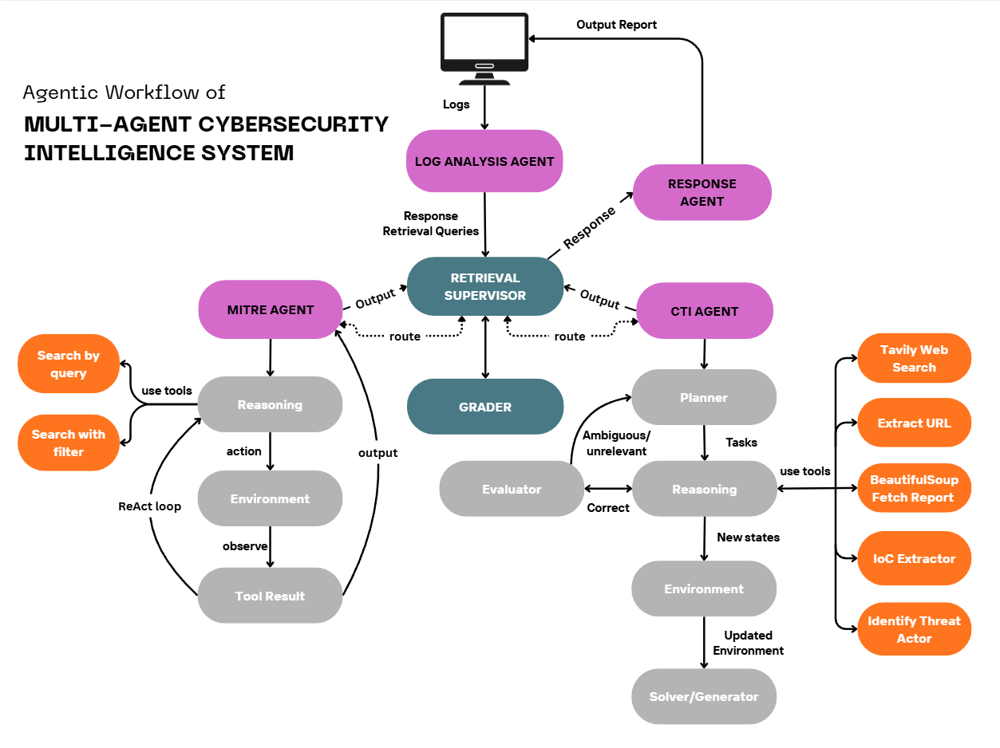
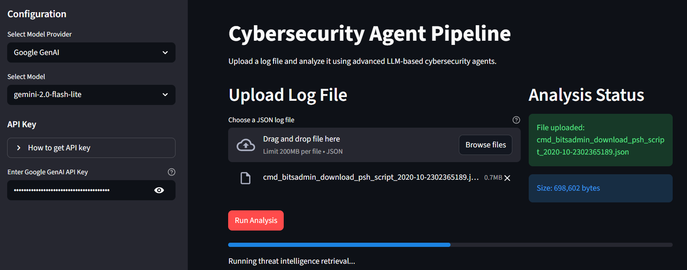
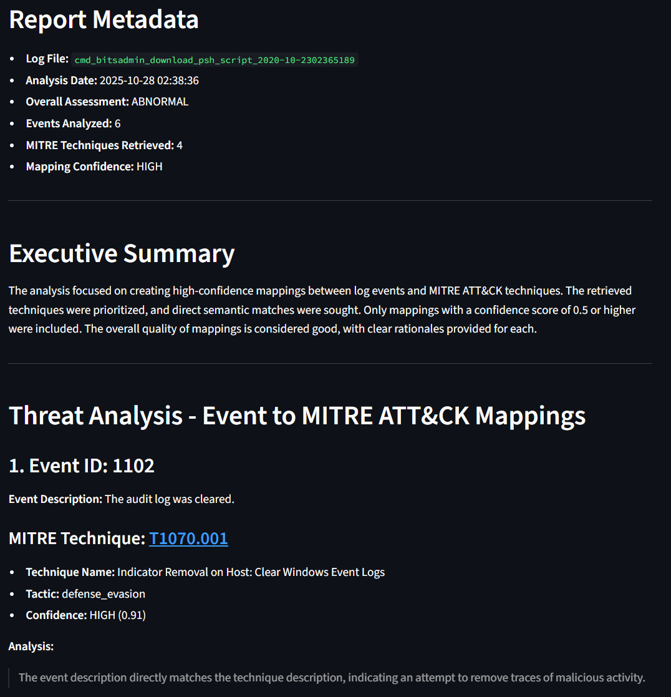
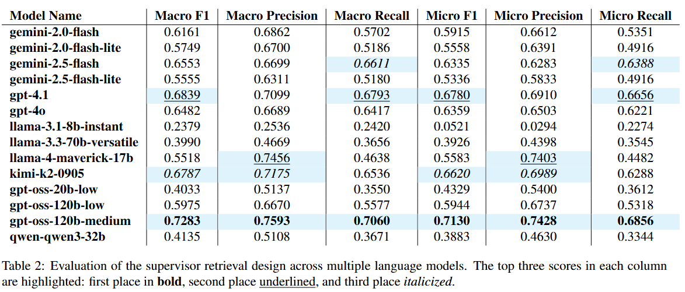
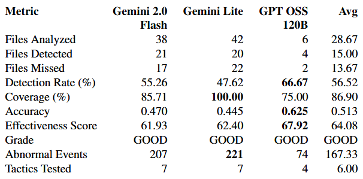

> **CipherMind** (final-year project, work in progress): a fully local RAG security-log investigation assistant
> (Sysmon logs → ChromaDB retrieval over MITRE ATT&CK → Mistral via Ollama → cited report → MongoDB → precision/recall/F1).
> See `PLAN.MD`. New code: `tools/`, `agents/`, `config.py`, `build_kb.py`, `check_*.py`, `data/`.
>
> Built on **Cyber-Agent** by minhan6559 and team (https://github.com/minhan6559/Cyber-Agent). Their original code
> (`src/`, `app.py`, `self_learn/`, `cti_bench/`, `cyber_knowledge_base/`) and the README below are kept as reference.

# Cybersecurity Agent Pipeline - COS30049

A comprehensive LLM-based multi-agent cybersecurity analysis system that processes security logs and correlates them with MITRE ATT&CK techniques to provide detailed threat intelligence and mitigation recommendations.

## Table of Contents

- [Project Overview](#project-overview)
- [System Architecture](#system-architecture)
- [File Structure](#file-structure)
- [Quick Start Guide](#quick-start-guide)
- [Advanced Usage](#advanced-usage)
- [Evaluation and Testing](#evaluation-and-testing)
- [Model Performance](#model-performance)
- [Project Architecture](#project-architecture)

## Project Overview

This project implements a sophisticated multi-agent cybersecurity analysis system that combines traditional log analysis with modern LLM-based reasoning. The system processes security logs from various sources and applies advanced AI techniques to:

1. **Log Analysis Agent**: Detects suspicious activities and anomalies in security logs
2. **Retrieval Supervisor**: Intelligently searches MITRE ATT&CK knowledge base for relevant techniques
3. **Response Agent**: Synthesizes findings into comprehensive threat intelligence reports

### Key Features

- **Multi-Agent Architecture**: Hierarchical agent system using LangGraph for orchestration
- **MITRE ATT&CK Integration**: Semantic search over comprehensive technique database
- **Real-time Analysis**: Process security logs and generate immediate threat assessments
- **Web Interface**: User-friendly Streamlit application for easy interaction
- **Comprehensive Evaluation**: Built-in evaluation framework for system performance testing

## System Architecture

### Current System Architecture

>**Note**: The full hierarchical design is still under development. Currently, the system uses a linear pipeline with separate reflection on each module.

```
Linear Pipeline (Current Implementation)
├── Log Analysis Agent
│   ├── Event ID Validation
│   ├── Timeline Analysis
│   ├── Command Decoding
│   └── Anomaly Detection
├── Retrieval Supervisor
│   ├── MITRE Database Agent
│   ├── Retrieval Grader Agent
│   └── CTI Agent (Under Development - Temporarily Disabled)
│       └── Online CTI Report Analysis
└── Response Agent
    ├── Threat Correlation
    ├── Attack Chain Reconstruction
    └── Mitigation Recommendations
```

<div align="center">
  
  <p><em>Figure 1: Current Multi-Agent System Architecture</em></p>
</div>

### Current Workflow

1. **Input**: User uploads JSON log file (Mordor dataset format)
2. **Log Analysis**: Agent analyzes logs for suspicious activities and IOCs with self-reflection
3. **Intelligence Retrieval**: Retrieval supervisor searches MITRE ATT&CK database for relevant techniques with quality assessment
4. **Correlation**: Response agent correlates findings to reconstruct potential attack chains with report refinement
5. **Output**: Comprehensive threat intelligence report with mitigation suggestions

>**Note**: Each module operates independently with its own reflection mechanism. The full hierarchical coordination is planned for future development.

### Planned Hierarchical Architecture (future plan)

```
Global Supervisor Agent (Future)
├── Log Analysis Agent
├── Retrieval Supervisor (Sub-supervisor)
│   ├── MITRE Database Agent
│   ├── Retrieval Grader Agent
│   └── CTI Agent (Web-facing CTI analysis)
└── Response Agent
```


## File Structure

```
Cyber-Agent/
├── app.py                              # Streamlit web application
├── requirements.txt                    # Python dependencies
│
├── src/                                # Source code modules
│   ├── agents/                         # Multi-agent system components
│   │   ├── log_analysis_agent/        # Log analysis and anomaly detection
│   │   ├── retrieval_supervisor/      # CTI knowledge retrieval coordination
│   │   ├── database_agent/            # Knowledge base search agent
│   │   ├── grader_agent/              # Retrieval quality assessment
│   │   ├── cti_agent/                 # CTI report analysis (under development)
│   │   └── response_agent/            # Final report generation
│   │
│   ├── full_pipeline/                 # Complete pipeline orchestration
│   │   └── simple_pipeline.py         # Main pipeline implementation
│   │
│   ├── knowledge_base/                # MITRE ATT&CK knowledge base
│   │   └── cyber_knowledge_base.py    # Vector database management
│   │
│   ├── scripts/                       # Utility and evaluation scripts
│   │   ├── extract_mitre_techniques.py    # MITRE data extraction
│   │   ├── build_cyber_database.py        # Knowledge base construction
│   │   ├── cti_bench_evaluation.py        # CTI Bench evaluation
│   │   ├── execute_pipeline_all_datasets.py # Full dataset processing
│   │   └── run_evaluation.py              # Evaluation pipeline
│   │
│   └── evaluation/                    # Evaluation framework
│       ├── cti_bench/                 # CTI Bench evaluation tools
│       └── full_pipeline/             # Pipeline evaluation metrics
│
├── mordor_dataset/                    # Sample security logs
│   ├── datasets/                      # JSON log files by attack type
│   └── eval_output/                   # Evaluation results
│
├── mitre_data/                        # MITRE ATT&CK data
│   ├── enterprise-attack.json         # Full ATT&CK dataset
│   └── techniques.json                # Processed techniques
│
├── cyber_knowledge_base/              # Vector database storage
│   ├── chroma/                        # ChromaDB vector store
│   └── bm25_retriever.pkl            # BM25 keyword search index
│
└── cti_bench/                         # CTI Bench evaluation data
    ├── datasets/                      # CTI Bench datasets
    └── eval_output/                   # Evaluation results
```

## Quick Start Guide

### Option 1: Online Demo (Recommended)

Visit the live demo at: [Our Hugging Face Space](https://huggingface.co/spaces/minhan6559/Log-Analysis-MultiAgent)

### Option 2: Local Web Application

#### Environment Setup

**Prerequisites**

- Python 3.11 or higher
- Git
- CUDA-compatible GPU (optional, for faster processing)

**Step-by-Step Installation**

1. **Clone the Repository**
   ```bash
   git clone https://github.com/minhan6559/Cyber-Agent.git
   cd Cyber-Agent
   ```

2. **Create Virtual Environment**

   **Option A: Using Conda (Recommended)**
   ```bash
   conda create -n cyber_agent python=3.11
   conda activate cyber_agent
   ```

   **Option B: Using Python venv**
   ```bash
   python -m venv cyber_agent
   source cyber_agent/bin/activate  # On Windows: cyber_agent\Scripts\activate
   ```

3. **Install Dependencies**
   ```bash
   pip install -r requirements.txt
   ```

4. **Optional: GPU Support**
   ```bash
   # For CUDA 12.6 (recommended)
   pip install torch==2.9.0 torchvision==0.24.0 --index-url https://download.pytorch.org/whl/cu126
   
   # For CPU-only (if no GPU available)
   pip install torch==2.9.0 torchvision==0.24.0
   ```

5. **Create `.env` File**
   
   Create a `.env` file in the root directory with the following API keys required for running the local web app:
   
   ```env
   # LLM you need - Only for running script, web app will require input on the interface
   GOOGLE_API_KEY=
   OPENAI_API_KEY=
   GROQ_API_KEY=

   # Must have api for tool calling
   TAVILY_API_KEY=
   SHODAN_API_KEY=
   VT_API_KEY=  # For virus total

   # Hugging face API that have access to google embedding gemma 300m 
   HF_TOKEN=

   # Langsmith
   LANGSMITH_API_KEY=
   LANGSMITH_PROJECT=
   LANGSMITH_TRACING=
   ```
   
   > **Note**: The LLM API keys (GOOGLE_API_KEY, OPENAI_API_KEY, GROQ_API_KEY) are optional for the web app as you can enter them directly in the interface. However, TAVILY_API_KEY, SHODAN_API_KEY, VT_API_KEY, HF_TOKEN, and Langsmith keys are required for tool calling functionality.

6. **Verify Installation**
   ```bash
   python -c "import torch; print('CUDA available:', torch.cuda.is_available())"
   python -c "import streamlit; import langchain; print('All packages installed successfully')"
   ```

#### Running the Application

1. **Start the Streamlit App**
   ```bash
   streamlit run app.py
   ```

2. **Access the Web Interface**
   - Open your browser to `http://localhost:8501`
   - Select your preferred LLM model (Google GenAI, Groq, or OpenAI)
   - Enter your API key for the selected provider
   - Upload a JSON log file from `mordor_dataset/datasets/`
   - Click "Run Analysis" to generate a comprehensive threat report

<div align="center">
  
  <p><em>Figure 2: Streamlit Web Application - Model Selection and Configuration</em></p>
</div>

3. **View Results**
   - The system will display real-time progress
   - Results include threat assessment, abnormal events, and mitigation recommendations
   - Download detailed reports in JSON and Markdown formats

**Required Dependencies**

The `requirements.txt` includes these key packages:
- **streamlit**: Web application framework
- **langchain**: LLM framework and tools
- **langgraph**: Multi-agent orchestration
- **chromadb**: Vector database for semantic search
- **sentence-transformers**: Embedding models
- **mitreattack-python**: MITRE ATT&CK data processing
- **pandas**: Data manipulation
- **numpy**: Numerical computing

<div align="center">
  
  <p><em>Figure 3: Streamlit Web Application - Analysis Results and Threat Intelligence Report</em></p>
</div>

## Advanced Usage

### Model Name Format

The system uses the LangChain `init_chat_model` format for model specification. Models are specified using the `'{model_provider}:{model}'` format as required by the [LangChain documentation](https://python.langchain.com/api_reference/langchain/chat_models/langchain.chat_models.base.init_chat_model.html).

#### Supported Model Providers and Examples

**Google GenAI**:
```python
"google_genai:gemini-2.0-flash"
"google_genai:gemini-2.0-flash-lite"
"google_genai:gemini-2.5-flash-lite"
```

**Groq**:
```python
"groq:openai/gpt-oss-120b"
"groq:openai/gpt-oss-20b"
"groq:llama-3.1-8b-instant"
"groq:llama-3.3-70b-versatile"
"groq:moonshotai/kimi-k2-instruct-0905"
```

**OpenAI**:
```python
"openai:gpt-4o"
"openai:gpt-4.1"
```

**Other Providers**:
```python
"anthropic:claude-3-5-sonnet-latest"
"ollama:llama3.1:8b"
```

#### Usage in Code

```python
from langchain.chat_models import init_chat_model

# Initialize model using the format
model = init_chat_model("google_genai:gemini-2.0-flash", temperature=0.1)

# Use in pipeline
result = analyze_log_file(
    log_file="sample.json",
    model_name="groq:openai/gpt-oss-120b",
    temperature=0.1
)
```

### Building the Knowledge Base from Scratch

If you want to reproduce the entire system and evaluation from scratch:

1. **Extract MITRE ATT&CK Techniques**
   ```bash
   python src/scripts/extract_mitre_techniques.py
   ```

2. **Build the Vector Database**
   ```bash
   python src/scripts/build_cyber_database.py ingest --techniques-json ./mitre_data/techniques.json
   ```

3. **Test the Knowledge Base**
   ```bash
   python src/scripts/build_cyber_database.py test --interactive
   ```

### Running CTI Bench Evaluation

Test the retrieval supervisor system using the CTI Bench dataset. This evaluation tests the system's ability to extract and map MITRE ATT&CK techniques from cybersecurity threat intelligence reports.

> **Note**: Currently, only the CTI-ATE (Attack Technique Extraction) dataset is fully supported and tested. The CTI-MCQ (Multiple Choice Questions) dataset is not fully developed yet.

#### Prerequisites

Ensure you have the CTI Bench dataset files in the correct location:
```bash
cti_bench/datasets/
├── cti-ate.tsv      # Attack Technique Extraction dataset
└── cti-mcq.tsv      # Multiple Choice Questions dataset
```

#### Evaluation Modes

**1. Quick Test (Recommended for first-time users)**
```bash
# Test with 2 samples from both datasets
python src/scripts/cti_bench_evaluation.py --mode quick --num-samples 2

# Test with 5 samples from ATE dataset only
python src/scripts/cti_bench_evaluation.py --mode quick --num-samples 5 --datasets ate

# Test with 3 samples from MCQ dataset only
python src/scripts/cti_bench_evaluation.py --mode quick --num-samples 3 --datasets mcq
```

**2. Connection Test**
```bash
# Test if the supervisor can connect to the knowledge base
python src/scripts/cti_bench_evaluation.py --mode test --llm-model google_genai:gemini-2.0-flash
```

**3. Full Evaluation**
```bash
# Full evaluation on ATE dataset (recommended)
python src/scripts/cti_bench_evaluation.py --mode full --datasets ate --llm-model google_genai:gemini-2.0-flash

# Full evaluation on MCQ dataset
python src/scripts/cti_bench_evaluation.py --mode full --datasets mcq --llm-model groq:openai/gpt-oss-120b

# Full evaluation on both datasets
python src/scripts/cti_bench_evaluation.py --mode full --datasets all --llm-model openai:gpt-4o
```

#### Getting Help

For detailed parameter information and advanced configuration options:
```bash
python src/scripts/cti_bench_evaluation.py --help
```

#### Understanding Results

The evaluation generates several output files:
- `cti-ate_{model_name}_{timestamp}.csv`: Detailed results for ATE dataset
- `cti-mcq_{model_name}_{timestamp}.csv`: Detailed results for MCQ dataset
- `evaluation_summary_ate_{model_name}_{timestamp}.json`: Summary metrics for ATE
- `evaluation_summary_mcq_{model_name}_{timestamp}.json`: Summary metrics for MCQ

**Key Metrics**:
- **Macro F1**: Overall technique extraction performance
- **Success Rate**: Percentage of successfully processed samples
- **Accuracy**: Correct technique identification rate
- **Precision/Recall**: Detailed performance breakdown

### Full Pipeline Evaluation

Run the complete evaluation on the Mordor dataset:

1. **Execute Pipeline on All Datasets**
   ```bash
   python src/scripts/execute_pipeline_all_datasets.py --model google_genai:gemini-2.0-flash
   ```

2. **Run Evaluation Metrics**
   ```bash
   python src/scripts/run_evaluation.py
   ```

3. **View Results**
   - Check `mordor_dataset/eval_output/evaluation_results/` for detailed metrics
   - Review `model_metrics.csv` for performance comparisons

## Evaluation and Testing

### CTI Bench Evaluation

The system includes comprehensive evaluation using the CTI Bench dataset. CTI Bench is a comprehensive suite of benchmark tasks and datasets designed to evaluate Large Language Models (LLMs) in the field of Cyber Threat Intelligence (CTI), as described in the [CTI-Bench repository](https://github.com/xashru/cti-bench).

- **ATE (Attack Technique Extraction)**: Tests technique identification and retrieval accuracy
- **MCQ (Multiple Choice Questions)**: Tests knowledge base retrieval quality
- **Metrics**: F1-score, accuracy, precision, recall, and success rates

Below is evaluation result of the supervisor retrieval design across multiple language models on CTI-ATE benchmark

<div align="center">
  
  <p><em>Figure 4: CTI-ATE Evaluation Results - Performance Comparison Across Multiple Language Models</em></p>
</div>

### Mordor Dataset Evaluation

Full evaluation on real-world security logs using the [Mordor dataset](https://github.com/UraSecTeam/mordor). The Mordor project provides pre-recorded security events generated after simulating adversarial techniques in the form of JSON files, categorized by platforms, adversary groups, tactics and techniques defined by the MITRE ATT&CK Framework.

#### Evaluation Results Summary

Three LLM models were evaluated across 86 log files covering 7 MITRE ATT&CK tactics. All models achieved "GOOD" grades with effectiveness scores of 61.93-67.92%.

<div align="center">
  
  <p><em>Figure 5: Pipeline Evaluation Results</em></p>
</div>

**Evaluation Metrics:**
- **Detection Rate**: Percentage of log files with successfully identified threats
- **Coverage**: Percentage of attack tactics the model can detect (breadth)
- **Accuracy**: Per-tactic detection rate averaged across all tactics
- **Effectiveness Score**: Weighted composite (40% detection + 30% coverage + 30% accuracy)
- **Standard Metrics**: Precision, Recall, F1-score for classification performance

### Available Models

The system supports multiple LLM providers:

- **Google GenAI**: `gemini-2.0-flash`, `gemini-2.5-flash-lite`
- **Groq**: `gpt-oss-120b`, `llama-3.1-8b-instant`, `llama-3.3-70b-versatile`
- **OpenAI**: `gpt-5-mini`, `gpt-5`, `gpt-4.1-mini`

## Project Architecture

### Design Principles

1. **Modular Design**: Each agent operates independently with clear interfaces
2. **LLM-Driven Reasoning**: Prefers AI reasoning over hard-coded rules
3. **Hierarchical Coordination**: Supervisor agents manage specialized sub-agents
4. **Comprehensive Evaluation**: Built-in testing and validation frameworks
5. **Scalable Processing**: Efficient handling of large log datasets

### Key Components

#### Log Analysis Agent
- **Purpose**: Detects suspicious activities in security logs
- **Capabilities**: Event validation, timeline analysis, command decoding
- **Tools**: Field reduction, event ID extraction, timeline building, base64 decoding
- **Reflection**: Self-critique and iterative improvement

#### Retrieval Supervisor
- **Purpose**: Coordinates MITRE ATT&CK technique retrieval
- **Sub-agents**: 
  - Database agent (semantic search over MITRE knowledge base)
  - Grader agent (quality assessment and iterative refinement)
  - CTI Agent (under development - web-facing CTI report analysis)
- **Features**: Iterative refinement, quality control, multi-query search
- **Reflection**: Quality assessment and retrieval improvement

#### Response Agent
- **Purpose**: Synthesizes findings into comprehensive reports
- **Capabilities**: Threat correlation, attack chain reconstruction, mitigation recommendations
- **Outputs**: Threat assessments, attack chains, mitigation recommendations
- **Formats**: JSON, Markdown, structured data
- **Reflection**: Report quality assessment and improvement

### Extensibility

The modular architecture supports:
- **New Data Sources**: Implement custom log processors
- **Additional Agents**: Add specialized analysis components
- **Custom Evaluations**: Extend evaluation frameworks
- **Model Integration**: Support for new LLM providers

## Contributing

This is a university project demonstrating LLM-based multi-agent systems for cybersecurity. The system is designed for educational purposes and showcases the power of modern AI in security analysis.

## License

This project is developed for educational purposes as part of COS30049 coursework.

## Acknowledgments

- **MITRE ATT&CK**: For the comprehensive attack technique database
- **Mordor Dataset**: For realistic security log samples
- **LangChain & LangGraph**: For the multi-agent framework
- **Streamlit**: For the web interface
- **Hugging Face**: For model hosting and deployment
